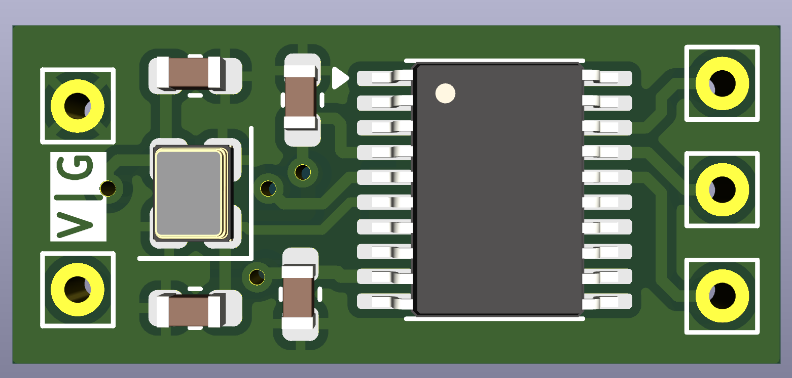
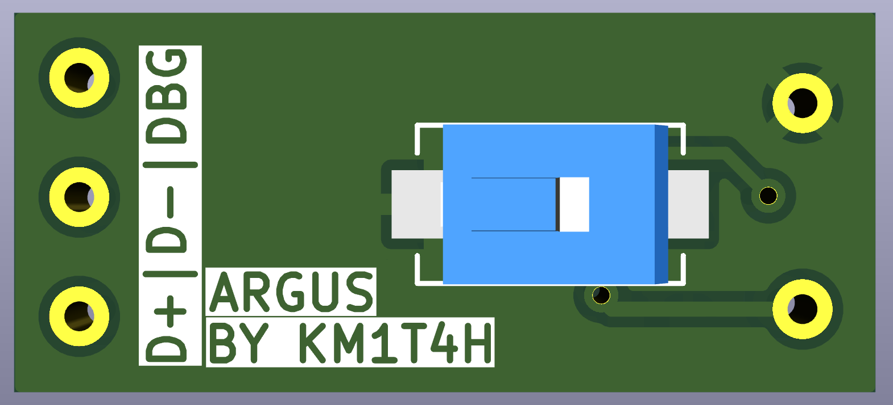

# Argus Hardware

> [!NOTE]
> **Please bear in mind that the pcb was primarily created for enjoyment
> and educational endeavors.**

> This is the first version of the board, featuring only basic functionality.

## 🛠️  PCB

> This section showcases the 3D views of the PCB, generated using KiCad.
> These models provide a clear visual reference for component placement,
> board layout, and connector orientation.

### KiCAD 3D Model

