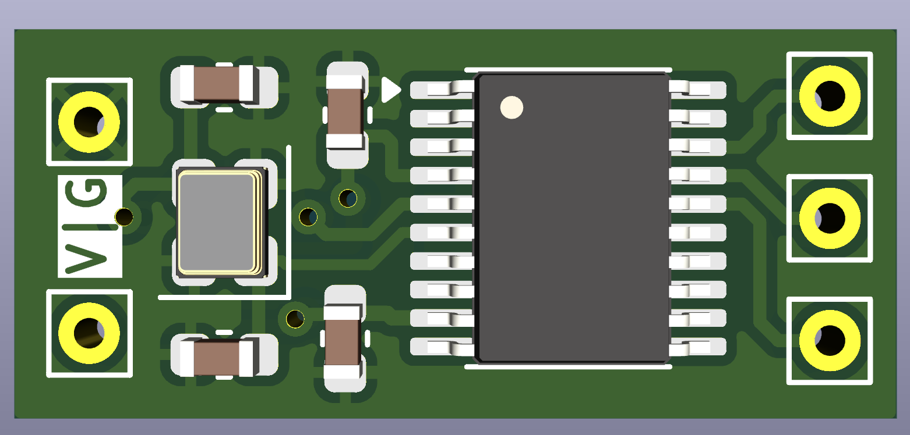
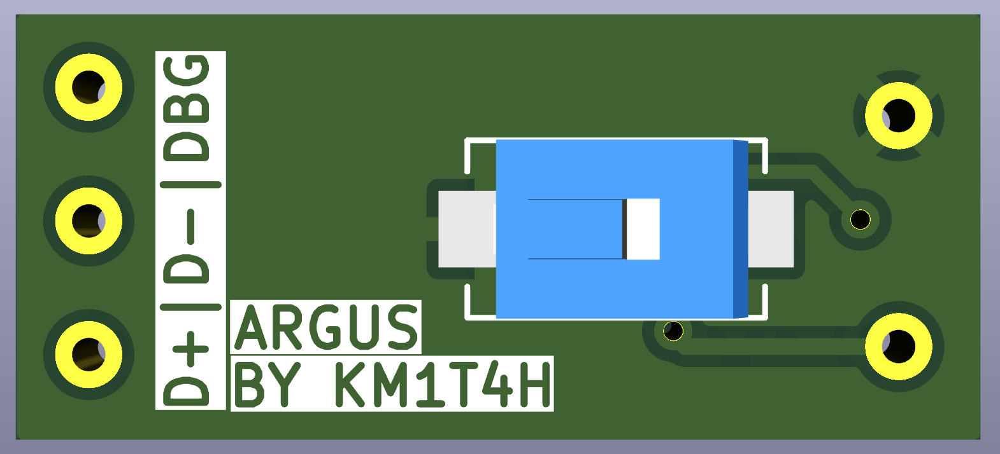

# Argus Hardware

> [!NOTE]
> **Please bear in mind that the pcb was primarily created for enjoyment
> and educational endeavors.**

> This is the first version of the board, featuring only basic functionality.

## 📋 Hardware Summary

Argus is a compact, two-layer CH32V003 board built around an external 24 MHz
crystal for accurate timing. The design is deliberately small: one MCU, its clock,
decoupling, a reset/user button, and a handful of I/O pads.

| Ref     | Part                       | Value / Package                         | Qty |
|---------|----------------------------|-----------------------------------------|-----|
| U1      | CH32V003FxPx (RISC-V MCU)  | TSSOP-20, 4.4×6.5 mm, 0.65 mm pitch     | 1   |
| X1      | Crystal                    | 24 MHz, SMD 2520 4-pin (2.5×2.0 mm)     | 1   |
| C2, C3  | Load capacitors            | 20 pF, 0603                             | 2   |
| C1, C4  | Decoupling capacitors      | 100 nF, 0603                            | 2   |
| SW1     | Tactile button (SPST)      | EVQ-PE1 SMD                             | 1   |
| J1–J5   | Pads: VCC, GND, D+, D−, DBG | Flat-fork pin, Ø0.7 mm                  | 5   |

- **MCU:** [CH32V003](https://www.wch-ic.com/products/CH32V003.html) — 32-bit RISC-V (RV32EC), 48 MHz core, 16 KB flash / 2 KB SRAM.
- **Clock:** external 24 MHz crystal (C2/C3 load caps).
- **Power:** +5 V supply rail.
- **USB:** D+/D− pads wire inline to the USB cable's physical D+/D− lines to tap the data.
- **Programming/debug:** single-wire debug on the DBG (SWIO) pad, e.g. with a WCH-LinkE.

> Gerbers and drill files are fab-ready under [`argus/gerber/`](argus/gerber/).

## 📐 Schematic

The full schematic is available as a PDF: [`argus/schematic.pdf`](argus/schematic.pdf).

## 🛠️  PCB

> This section showcases the 3D views of the PCB, generated using KiCad.
> These models provide a clear visual reference for component placement,
> board layout, and connector orientation.

### KiCAD 3D Model

